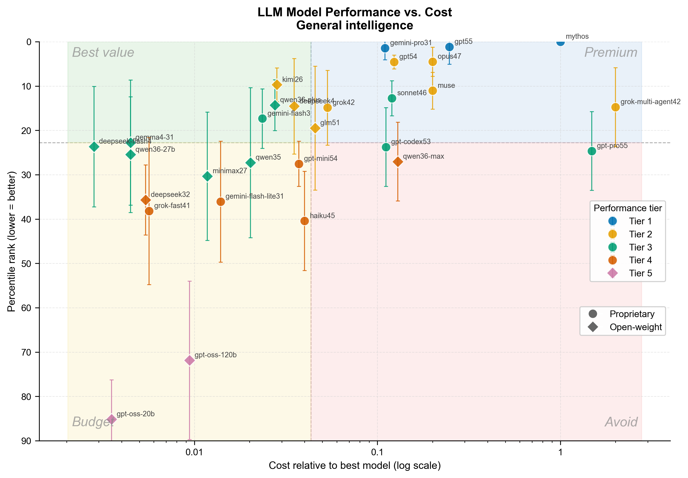
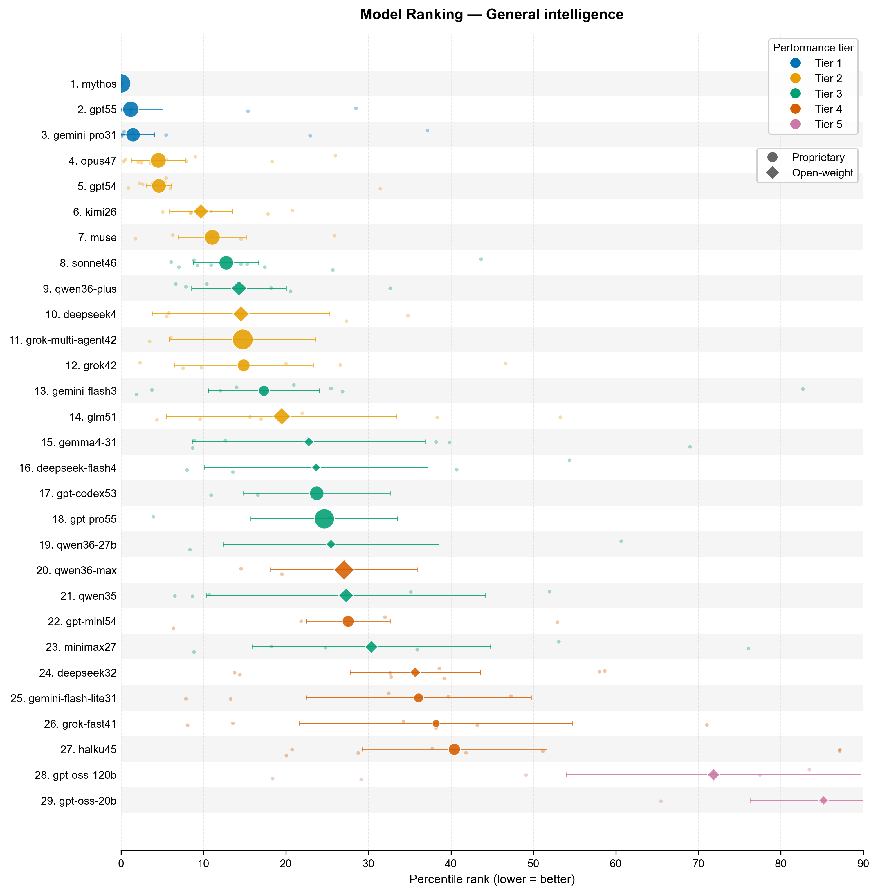

# LLM Benchmark Aggregator

A command-line tool that computes a unified model ranking from multiple benchmark leaderboards. It normalizes each benchmark score to a common 0–1 scale (the gap to the best tracked model), takes the median across benchmarks, shrinks models with few benchmarks toward a below-average result, and outputs a single sorted table so you can compare models at a glance. Rank ranges and tiers come from resampling the benchmarks, so they show how much each position depends on which benchmarks happen to be included.

Visualize model performance with tiering: Generate scatter plots showing performance vs. cost, with models color-coded by "indistinguishable from best" performance tiers.

## Quick start

```shell
# evaluate across general reasoning leaderboards 
python rank_models.py general  
```

Valid categories: `general`, `coding`, `agentic`, `stem`.

The above command will produce the following output:

```text
+-----------------------------------------------------------------------------------------------------+
| Rank  | Model                   | Rank range | Gap    | -IQR   | +IQR   | # Benchmarks  | Rel. Cost |
+-----------------------------------------------------------------------------------------------------+
| 1     | fable52                 | 1-2        | 0.038  | 0.000  | 0.014  | 8             | 1.000     |
| 2     | opus55                  | 2-3        | 0.055  | 0.023  | 0.073  | 13            | 0.500     |
| 3     | g4carbon                | 1-5        | 0.100  | 0.069  | 0.032  | 10            | 0.250     |
| 4     | gpt6astra               | 3-7        | 0.104  | 0.062  | 0.092  | 14            | 1.250     |
| 5     | kimi-k31-pro*           | 4-9        | 0.132  | 0.022  | 0.014  | 3             | 0.250     |
| 6     | gpt61sol                | 5-9        | 0.154  | 0.065  | 0.055  | 12            | 0.250     |
...
```

`kimi-k31-pro` has the third-best median, but it rests on only three benchmarks: shrinkage (Methodology §3) places it 5th, and resampling the benchmarks puts it anywhere from 4th to 9th.

For the plots:

```shell
# generate performance plot for general reasoning
python rank_models.py general --plot

# generate scatter plot with quadrant overlays
python rank_models.py general --plot --quadrants
```

Plots are written to `figures/General intelligence.png` and `figures/General intelligence_ranking.png` (the `figures/` directory is created automatically).

This will output two plots. The first is the average ranking as a function of API cost:
  
**Figure 1: General intelligence vs model cost.** Y-axis is the median gap to the best tracked model, as a percentage of each benchmark's range (0 = best). X-axis is the cost relative to the best-ranked model (log scale; best model = 1). Colors indicate the model tier. Error bars span Q1 to Q3 of a model's per-benchmark gaps: they show how much the model varies across benchmarks, not how precisely its median is known (models on fewer than 3 benchmarks have none). Circles = proprietary models; diamonds = open-weight models.

The second plot is a different visualization of the tiers: 
  
**Figure 2: Model ranking (general intelligence).** Bigger circles indicate more expensive models. Small semi-transparent dots show the individual per-benchmark gaps, revealing the spread, skewness, and outliers behind each aggregate score. The `[a–b]` after each name is the model's 68% rank range from resampling benchmarks.

To regenerate plots for all four categories in one shot:

```shell
make refresh-plots
```

`make refresh-plots` loops over `general`, `coding`, `agentic`, and `stem`, calling `rank_models.py --plot --quadrants <category>` for each and writing all PNGs into `figures/`.

If you want to mirror those PNGs into another directory, set `WEBSITE_PLOTS_DIR`:

```shell
make refresh-plots WEBSITE_PLOTS_DIR=/path/to/site/assets
```

For more detailed information about the ranking procedure and for debugging:

```
# show detailed tiering diagnostics
python rank_models.py general --debug

# combine debug and plot
python rank_models.py general -d -p
```


### Requirements

**Core functionality:** Python 3.10+ (standard library only)

**Plotting feature (optional):** pandas, matplotlib, numpy
```bash
pip install pandas matplotlib numpy  # only needed for --plot flag
```

### Command-line Arguments

```
python rank_models.py [category] [-p|--plot] [-d|--debug] [-q|--quadrants]
```

| Argument | Description |
|----------|-------------|
| `category` | Ranking category to compute. One of `general`, `coding`, `agentic`, `stem`. Defaults to `coding` if not provided. |
| `-p`, `--plot` | Generate PNG scatter plots of model performance vs. cost with tiering visualization. Written to `figures/<Category title>.png` and `figures/<Category title>_ranking.png`. |
| `-d`, `--debug` | Show detailed tiering diagnostics: each tier leader, every candidate's bootstrap probability of matching it, and the final tier assignments. |
| `-q`, `--quadrants` | Overlay quadrant dividers and labels on the scatter plot. Divides the chart into four regions — **Best value** (low cost, high perf), **Premium** (high cost, high perf), **Budget** (low cost, low perf), **Avoid** (high cost, low perf) — using the geometric mean of cost and median score as midpoints. Requires `--plot`. |

### Automation shortcuts

```bash
make refresh-plots
make refresh-ranking-data
make test
make validate
```

- `make refresh-plots` regenerates all plot PNGs for the four categories.
- `make refresh-ranking-data` rewrites website JSON under `docs/data/`.
- `make test` runs `pytest tests/ -v`.
- `make validate` runs `ruff`, `mypy --strict`, `make test`, and a temporary-directory JSON export smoke test.

## Input format for data files

Active model data lives in two centralized TOML files under `data/`, parsed with Python's
standard-library `tomllib`. `data/retired.toml` is a historical archive and is not loaded
into rankings or website exports.

### `data/benchmarks.toml`

One TOML table per benchmark. Each benchmark has:

- `categories`: **required** list of one or more category tags (`"general"`, `"coding"`, `"agentic"`, `"stem"`).
- Either `min_score` (score-based) or `known_totals` (rank-based).
- A nested `[benchmark_name.scores]` table mapping model name to score or rank.

**Score-based** — model scores are numeric, higher = better. `min_score` sets the normalization floor. Use the lowest score on the full source leaderboard, including models not tracked here, and note the source in a comment. Every listed score must be at or above `min_score`; `rank_models.py` exits with an error otherwise. The floor sets how much a benchmark spreads models apart, so it effectively controls the benchmark's weight.

```toml
[artificial_analysis_agentic]
categories = ["coding", "agentic"]
min_score = 5

[artificial_analysis_agentic.scores]
gemini-flash3 = 50
gpt56sol = 74
opus55 = 70
```

**Rank-based** — models are mapped to integer ranks (lower = better). `known_totals` is the total number of models evaluated on that leaderboard. Ranks must lie in `1..known_totals`.

```toml
[livebench_coding]
categories = ["coding"]
known_totals = 347

[livebench_coding.scores]
deepseek4 = 34
gemini-flash3 = 19
# Omit models that were not evaluated on this benchmark.
```

The included benchmarks are manually refreshed periodically; see commit history for the last update. Sources include:

https://livebench.ai/#/  
https://scale.com/leaderboard/  
https://arena.ai/leaderboard/  
https://www.tbench.ai/leaderboard/terminal-bench/2.0  
https://artificialanalysis.ai  
https://gorilla.cs.berkeley.edu/leaderboard.html#leaderboard  
https://www.swebench.com

Additional sources: [Vals Index](https://www.vals.ai/benchmarks/vals_index) and
[BioMysteryBench](https://www.vals.ai/benchmarks/biomysterybench).

Vals Index v2.1 contributes its overall GDP-weighted accuracy to the general and agentic
rankings. BioMysteryBench uses Vals AI's human-solvable subset with the Terminus 2 harness;
its overall and human-difficult scores are not mixed into that table. GDPval-AA uses the
v2.1 Elo ratings. These tables use the lowest score on each full source leaderboard as
the normalization floor, including models not tracked here.

### `data/models.toml`

One TOML table per model, alphabetical by model name. Each entry holds USD cost and model type:

```toml
[deepseek4]
cost = 5.1
open = true

[gemini-flash38]
cost = 9
open = false
```

| Field | Description |
|-------|-------------|
| `cost` | USD per 1M tokens (input + output combined). Missing pricing shows `N/A` in Rel. Cost column. |
| `open` | `true` = open-weight model (drawn as a **diamond** in scatter plots). `false` = proprietary (drawn as a **circle**). |

Models absent from `models.toml` show `N/A` in the Rel. Cost column.


## Methodology

### 1. Normalization

**Score-based benchmarks** (all current benchmarks):

```
gap = (max_score - score) / (max_score - min_score)
```

`max_score` is the best score among tracked models, so the best tracked model gets 0.0 and a model at the floor gets 1.0. This is a gap to the leader, not a percentile: it says how far behind the best tracked model a model is, as a share of the benchmark's range. Because the best tracked model defines 0, adding a new top model shifts every other model's gap on that benchmark, so scores are comparable within one run but not across dates.

**Rank-based benchmarks:**

```
gap = rank / known_totals
```

This is a true fractional percentile: a rank of 10 on a 300-model leaderboard (0.033) counts for more than a rank of 10 on a 30-model leaderboard (0.333).

### 2. Median aggregation

A model's base score is the median of its gaps across all benchmarks it appears in. Every benchmark carries equal weight. The median is used instead of the mean for robustness against outlier benchmarks where a model performs unusually well or poorly.

Benchmarks are not equally hard, and models are not all run on the same ones, so a model evaluated mostly on benchmarks where everyone scores near the top gets a better median than an equally capable model evaluated on harder ones. This matters most for models on few benchmarks; the rank ranges in §5 make it visible.

### 3. Coverage shrinkage

A median taken over one or two benchmarks is weak evidence. Each model's median is therefore blended with a phantom result worth one benchmark:

```
score = (n × median + prior) / (n + 1)
```

`n` is the number of benchmarks the model appears in. `prior` is the 75th percentile of all models' medians in the category, i.e. a below-average result. The model's own median gets weight n / (n + 1):

| Benchmarks appeared in | Weight on own median |
|------------------------|----------------------|
| 1                      | 50%                  |
| 2                      | 67%                  |
| 3                      | 75%                  |
| 5                      | 83%                  |
| 10                     | 91%                  |

- Every extra benchmark helps, by a little less each time. There is no cutoff.
- A thin model with a strong median is pulled down. A thin model whose median is already worse than the prior is pulled up toward it, because one bad result is also thin evidence.
- Every model is pulled slightly, including the leader, so the best score is no longer exactly 0. Between near-tied top models, the one with more benchmarks gains a little.
- **Why the 75th percentile:** until shown otherwise, a model with little evidence is assumed somewhat below average, which keeps the conservative intent of a penalty.
- **Why one benchmark's worth:** the value estimated from the data (within-model variance / between-model variance) is 0.8–1.7 on current data, but it swings from 0.3 to 13 across past snapshots. A fixed value keeps the rule stable from one data update to the next.
- The constants are `SHRINK_K` and `SHRINK_QUANTILE` in `ranking_math.py`. The prior is recomputed in every bootstrap resample (§5). Scores are capped at 1.0.

This replaced a flat sparse-data penalty (+0.25 for one benchmark, +0.10 for two, nothing from three on) in November 2026.

### 4. Asymmetric IQR bounds (spread)

The lower (`median − Q1`) and upper (`Q3 − median`) distances from the median to the first and third quartiles are kept separate, reflecting the skew of each model's per-benchmark gaps. Both are scaled by the same weight n / (n + 1) as the score (§3), so the bars still bracket it. They are drawn as error bars in plots. They describe how consistent a model is across benchmarks; they do not shrink as benchmarks are added, so they are not a measure of how precisely the median is known. Models with fewer than 3 benchmarks report `N/A` and get no error bar.

### 5. Uncertainty: benchmark bootstrap

The main source of uncertainty in an aggregate like this is which benchmarks happen to be included. To measure it, the tool resamples the category's benchmarks with replacement 2,000 times (fixed seed, so output is reproducible) and recomputes every model's score on each resample. All models share the same resample, so comparisons between models are paired. A model none of whose benchmarks were drawn is skipped for that resample.

- **Rank range:** the middle 68% of a model's ranks across resamples (roughly ±1σ). It is always widened, if needed, to include the listed rank.
- **Tiers:** see [Tiering Methodology](#tiering-methodology).

Models on few benchmarks naturally get wide rank ranges, because dropping or duplicating one of their benchmarks changes their median a lot.

### 6. Missing data

`None` values and absent keys are treated as "not evaluated" — the benchmark is simply excluded from that model's calculations.

### 7. Name matching

Model keys are compared as exact strings. No fuzzy matching or alias merging is performed (e.g. `qwen3-235` and `qwen3-80` remain separate models).


## Output

### ASCII Table

A sorted ASCII table (best model first):

See the sample in [Quick start](#quick-start).

| Column           | Description                                                                 |
|------------------|-----------------------------------------------------------------------------|
| **Rank**         | Position in the final aggregated ranking (1 = best).                        |
| **Model**        | Model identifier string (exactly as written in the file); `*` = open-weight. |
| **Rank range**   | 68% bootstrap rank interval (see Methodology §5).                           |
| **Gap**          | Median gap to the best tracked model after coverage shrinkage (§3), 0–1 scale (lower = better). |
| **-IQR / +IQR**  | Lower (`median − Q1`) and upper (`Q3 − median`) spread across benchmarks, or `N/A`. |
| **# Benchmarks** | Number of benchmarks the model was evaluated on.                            |
| **Rel. Cost**    | Cost relative to the best-ranked model (best = 1.000), or `N/A` if unavailable. |

The JSON export (`--export-json`) carries the same values per model (`avg_pct` holds the gap, `median_pct` the raw median before shrinkage, `rank_lo`/`rank_hi` the rank range) plus top-level `uncertainty` and `shrinkage` blocks with the bootstrap settings and the prior.

### Visualization Plot (`--plot`)

When using the `--plot` flag, the tool generates two PNG images in a `figures/` subdirectory (auto-created next to `rank_models.py`):

- `figures/<Category title>.png` — scatter plot of performance vs. cost
- `figures/<Category title>_ranking.png` — horizontal ranking chart

e.g. `python rank_models.py general --plot` writes `figures/General intelligence.png` and `figures/General intelligence_ranking.png`.

Open-weight models are drawn as **diamonds**; proprietary models are drawn as **circles**.

**Quadrant overlay (`--quadrants`, `-q`):** Pass this flag together with `--plot` to divide the scatter plot into four labelled, shaded regions. The vertical divider is placed at the geometric mean of all plotted model costs (log-scale midpoint); the horizontal divider sits at the median aggregate score. This makes it easy to spot which models offer the best performance per dollar.

#### Tiering Methodology

Models are grouped into performance tiers using the benchmark bootstrap (Methodology §5):

1. **Tier 1**: The best-ranked model is the leader. Walking down the ranking, each next model joins the tier while it scores at least as well as the leader in at least 16% of the resamples where both have data.
2. **Next tier**: The first model that fails this test becomes the next leader, and the walk continues from there.
3. **Repeat** until every model has a tier.

**Mathematical criterion**: a candidate joins the current leader's tier if
```
P(candidate_score ≤ leader_score) ≥ 0.16      (over bootstrap resamples)
```
0.16 is the one-sided tail of a ±1σ interval. Tiers are contiguous: a model is never in a better tier than a model ranked above it. Use `--debug` to see every comparison. This is a descriptive grouping, not a formal multiple-comparison test.

## Extending the data

To add a new benchmark, append a new TOML table to `data/benchmarks.toml`:

```toml
[new_bench]
categories = ["general"]
known_totals = 40

[new_bench.scores]
gpt56sol = 1
opus55 = 2
```

Use `min_score` instead of `known_totals` for score-based benchmarks. Omit models that were not evaluated.

To add a new model, insert its key into `data/models.toml` and into each relevant benchmark's scores table:

```toml
[new-model]
cost = 300
open = false
```


## Why "Indistinguishable from Best" Tiering?

Traditional rankings treat every rank position as meaningfully different. This tool instead groups models whose order flips often enough when the benchmark set is resampled that the data cannot support a sharp separation.

This approach answers the practical question: "Which models belong in the current top cluster?" rather than forcing a strict total order out of sparse, noisy benchmark data.
